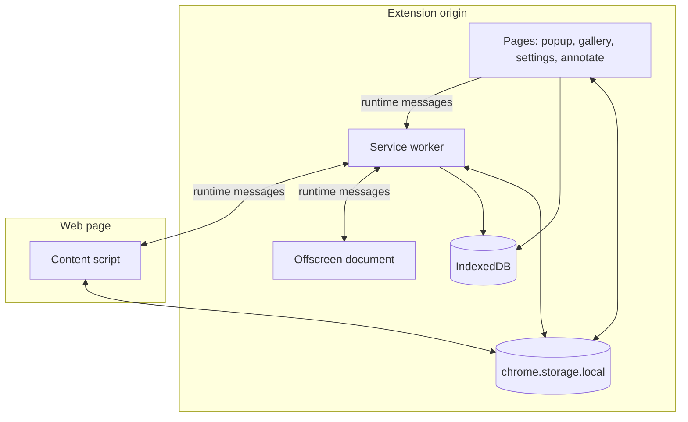
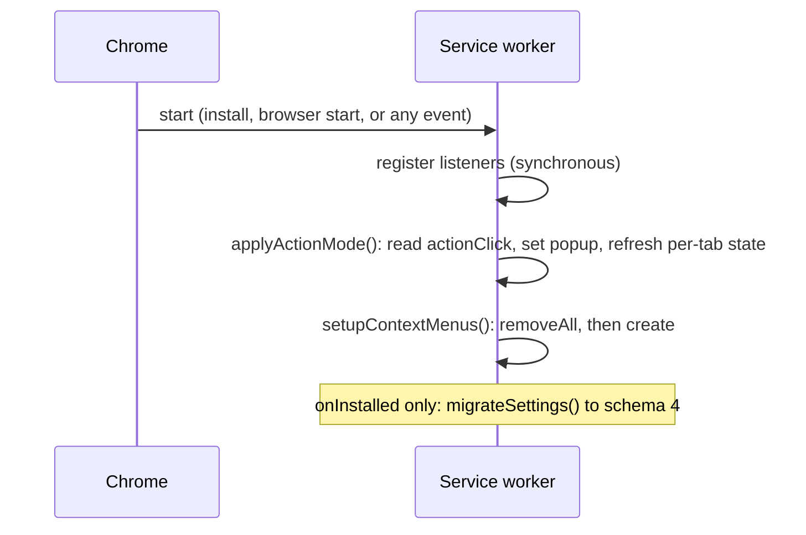
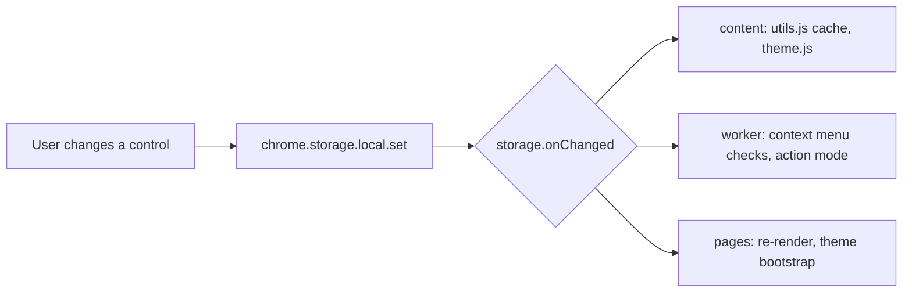

# Architecture

SwiftSelect is a Manifest V3 Chrome extension written in vanilla JavaScript. It has no runtime dependencies. The only build step is esbuild, which produces two self-contained bundles so that code injected into web pages never depends on a page's Content Security Policy.

This document describes the execution contexts, how they talk to each other, and who owns which piece of state.

<br>

## 1. Execution contexts

| Context | Entry files | Origin | Lifetime | Responsibility |
| :--- | :--- | :--- | :--- | :--- |
| Service worker | `background.js` (ES module) | extension | Event driven, may stop after about 30 s idle | Privileged APIs, routing, gallery writes |
| Content script | `contentScript.js` (bundle of `src/contentScript.js`) | isolated world of the page | Until the tab navigates | Capture UI, capture engine, in-page editor |
| Offscreen document | `offscreen.html`, `offscreen.js` | extension | Created on demand, closed after 30 s idle | Tab stream stitching, clipboard fallback |
| Extension pages | `popup`, `gallery`, `settings`, `annotate` | extension | While open | Quick menu, dashboard, preferences, standalone editor |



Two facts shape the whole design:

1. **Contexts share no memory.** Everything crosses a JSON message boundary, so images travel as data URLs or as blob URLs resolved inside the extension origin.
2. **IndexedDB is partitioned by origin.** A content script runs in the page's storage partition and cannot see the extension database. Captures are therefore handed to the service worker, which is the single writer on the capture path.

<br>

## 2. Module graph

```text
src/contentScript.js                 src/annotatePage.js
├── theme.js                         ├── theme.js
├── ui.js ── styles.min.css (text)   ├── ui.js
├── events.js                        ├── capture/annotate.js
└── capture/                         └── storage.js
    ├── region.js ── deliver.js
    ├── fullpage.js ── deliver.js
    ├── annotate.js ── deliver.js
    ├── download.js
    └── utils.js ── ../settings.js

background.js ── src/storage.js, src/settings.js          (native ES modules)
gallery.js    ── src/storage.js, src/settings.js, src/pageKit.js
options.js    ── src/storage.js, src/settings.js, src/pageKit.js
popup.js      ── src/storage.js, src/settings.js, src/pageKit.js
```

`src/settings.js` and `src/storage.js` are written as pure modules with no DOM or CSS imports, so the same file is loaded natively by the worker and pages and is also bundled into the page bundles.

Inside the page, modules reach each other through `window.SwiftSelect` (`theme`, `ui`, `events`, `capture`). That namespace exists to break import cycles: the capture modules call UI functions and the UI imports capture functions. The standalone editor page builds the same namespace with inert event hooks, which lets it reuse `annotate.js` unchanged.

<br>

## 3. Service worker lifecycle

A Manifest V3 worker is not a background page. Chrome starts it for an event and may terminate it once idle. SwiftSelect is built around that.

| Concern | Approach |
| :--- | :--- |
| Listener registration | Every `chrome.*.addListener` call sits at module top level, so events that wake the worker are never missed |
| Durable state | Preferences in `chrome.storage.local`, captures in IndexedDB |
| Session state | Last capturable tab per window in `chrome.storage.session` |
| In-memory state | Only short-lived items: the offscreen creation promise, the offscreen idle timer, and partially received gallery chunks (auto-discarded after 120 s) |
| Wake-up work | `applyActionMode()` and `setupContextMenus()` run on every start because they are idempotent |
| Keep-alive | None. An open message channel (`return true` from a listener) keeps the worker alive for the duration of that request, which is all a capture needs |

### Start-up sequence



### Toolbar action

The `actionClick` setting chooses between two behaviours.

| Value | Default popup | Click result |
| :--- | :--- | :--- |
| `region` (default) | none | `action.onClicked` fires and region selection starts immediately |
| `menu` | `popup.html` | Quick menu opens |

Per-tab overrides always win: restricted pages get `popup.html?view=restricted`, and `file://` pages without file access get `popup.html?view=file-access` plus an amber `FILE` badge.

<br>

## 4. Offscreen document

Workers have no DOM, no `getUserMedia` and no clipboard. One offscreen document covers all three needs with reasons `USER_MEDIA` and `CLIPBOARD`.

- **Creation** is guarded by `ensureOffscreen()`, which checks `hasDocument()` and shares one in-flight creation promise so concurrent requests cannot create two documents.
- **Stitching** for long pages: the worker obtains a stream id with `tabCapture.getMediaStreamId({ targetTabId })`, the document opens it with `getUserMedia`, and frames are read through `ImageCapture.grabFrame()`. The document drives scrolling by relaying `unroll-page`, `update-unroll` and `restore-unroll` actions to the content script through the worker.
- **Canvas processing** happens entirely inside the offscreen document: tiles are drawn onto one canvas, clamped to Chromium's canvas limits, encoded, and returned as a blob URL (plus a data URL when the result is under 20 MB of text).
- **Clipboard fallback**: `write-image-clipboard` writes a PNG when a page blocks the content script's own clipboard call.
- **Teardown**: `scheduleCloseOffscreen(30000)` closes the document after 30 seconds without work.

<br>

## 5. Message passing contracts

All messages are plain objects with a `type`. Async handlers return `true` and answer exactly once. A response is `{ success: boolean, error?: string, ... }` unless noted.

### Content script or page to service worker

| `type` | Payload | Response | Notes |
| :--- | :--- | :--- | :--- |
| `capture-visible-tab` | none | `{ success, dataUrl }` | PNG of the sender's window |
| `start-fullpage-capture` | `mode`, `frameInterval`, `format`, `quality` | `{ success, dataUrl?, blobUrl?, abort? }` | Starts the offscreen stream path |
| `write-image-to-clipboard` | `dataUrl` | `{ success }` | Clipboard fallback |
| `fetch-blob-url` | `blobUrl` | `{ success, dataUrl }` | Resolves an extension blob URL for a page that cannot fetch it |
| `download-file` | `url`, `filename` | `{ success, downloadId }` | `chrome.downloads.download` |
| `update-badge` | `text`, `color?` | none | Per-tab badge |
| `gallery-save` | `dataUrl`, `meta` | `{ success, id }` | Store one capture |
| `gallery-save-chunk` | `key`, `index`, `total`, `chunk`, `meta?` | `{ success, id? }` | Ordered chunks, `meta` on the last |
| `run-capture` | `mode`, `tabId?` | `{ success, tabId }` or `error: "no-target"` | From popup, gallery, settings |
| `open-gallery` | none | `{ success }` | Focus or open the dashboard |
| `open-settings` | `hash?` | `{ success }` | Focus or open the Gallery on `#settings` (plus `/section`) |
| `open-annotate` | `id` | `{ success }` | Open the standalone editor |
| `restore-tab-action` | none | none | Popup closed, restore per-tab state |

`meta` is `{ title, url, type, width, height }`. `mode` is one of `region`, `visible`, `full`, `horizontal`, `timer`.

### Service worker to content script

| `type` | Effect |
| :--- | :--- |
| `start-selection` | Build the capture UI and attach listeners |
| `capture-visible`, `capture-download` | Visible capture, after the configured delay |
| `capture-full`, `capture-horizontal` | Stitched capture, after the configured delay |
| `capture-timer` | Countdown (configured delay, or 3 s), then visible capture |
| `show-help-modal` | Shortcut help overlay |
| `show-settings-modal` | Opens the Settings tab |
| `fullpage-progress` | `{ progress, current, total }` for the progress label |
| `fullpage-action` | `{ action, data }` with `unroll-page`, `update-unroll`, `restore-unroll` |
| `apply-theme` | `{ theme }` applied immediately |

### Service worker to offscreen document

| `type` | Payload |
| :--- | :--- |
| `start-offscreen-capture` | `streamId`, `tabId`, `mode`, `frameInterval`, `format`, `quality` |
| `write-image-clipboard` | `dataUrl` |

### Offscreen document to service worker

| `type` | Payload | Relayed as |
| :--- | :--- | :--- |
| `offscreen-to-content` | `tabId`, `action`, `data` | `fullpage-action` to the tab, response passed back |
| `offscreen-progress` | `tabId`, `progress`, `current`, `total` | `fullpage-progress` to the tab |

### Why gallery saves are chunked

`runtime.sendMessage` serialises to JSON and has a hard size ceiling. A full-page PNG can exceed it. `deliver.js` therefore sends any data URL longer than 8 MB of text as ordered `gallery-save-chunk` messages and waits for each acknowledgement. The worker reassembles the string, converts it with `fetch(dataUrl).blob()`, builds the thumbnail and writes one record.

<br>

## 6. State management

There is no global store. Each kind of state has exactly one owner and one propagation mechanism.

| State | Owner | Read by | Propagation |
| :--- | :--- | :--- | :--- |
| Preferences | `chrome.storage.local` (schema in `src/settings.js`) | all contexts | `storage.onChanged` |
| Captures | IndexedDB `swiftselect_db` (`src/storage.js`) | worker, pages | `BroadcastChannel("swiftselect-gallery")` |
| Last capturable tab | `chrome.storage.session` | worker | read on demand |
| Capture session (selection rect, drag flags, freeze frame) | module variables in `events.js` and `ui.js` | content script | direct, reset by `cleanup()` |
| Editor scene (shapes, undo and redo stacks) | module variables in `annotate.js` | editor | direct, reset on close |
| Last captured blob | `download.js` | status pill, editor | direct |

### Settings flow



`normalizeSettings()` is applied on every read. Unknown or legacy values (for example the 1.x theme name `glass`) collapse to a valid value, so no context ever acts on a malformed setting.

The content script keeps a synchronous cache (`getOutputSettingsSync()`), because the code that decides how to encode a capture runs inside a user gesture and should not wait on storage.

### Gallery flow

Writes go through `addCapture()`, `updateCapture()`, `setFavorite()`, `trashCaptures()`, `restoreCaptures()`, `deleteCaptures()` and `emptyTrash()`. Each one posts a small change notice on the broadcast channel. The gallery page debounces those notices and reloads its list, which is how a capture taken in another tab appears without a refresh.

Deleting is two-stage. A delete sets `deletedAt` and the capture moves to Trash; only Trash operations remove records. `applyRetention()` enforces both clocks (auto-delete for old captures, expiry for Trash) in one cursor pass. The worker runs it at start-up, a few seconds after each stored capture and when the retention settings change; the gallery runs it before its first paint.

<br>

## 7. Failure containment

- **Capture never depends on the gallery.** `saveToGallery()` catches everything and returns a boolean. It runs alongside clipboard and download delivery and never delays the status pill.
- **Nothing is silently lost.** If auto-copy is the only destination and the clipboard refuses the image, the capture is downloaded instead and the status says so.
- **Restricted pages fail closed.** `isRestrictedUrl()` is checked before every injection and when choosing a capture target.
- **Oversized output is scaled, not dropped.** See the canvas limits in [CAPTURE_ENGINE.md](CAPTURE_ENGINE.md).
