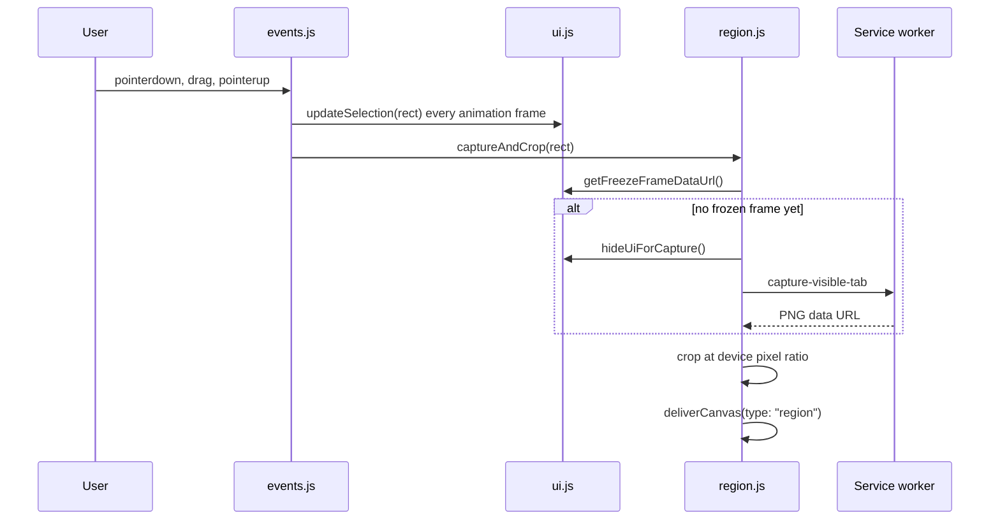
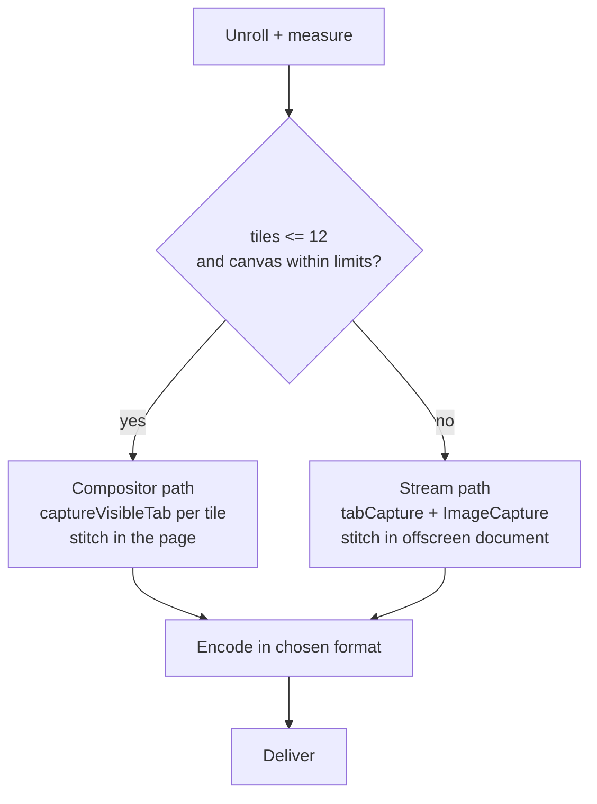
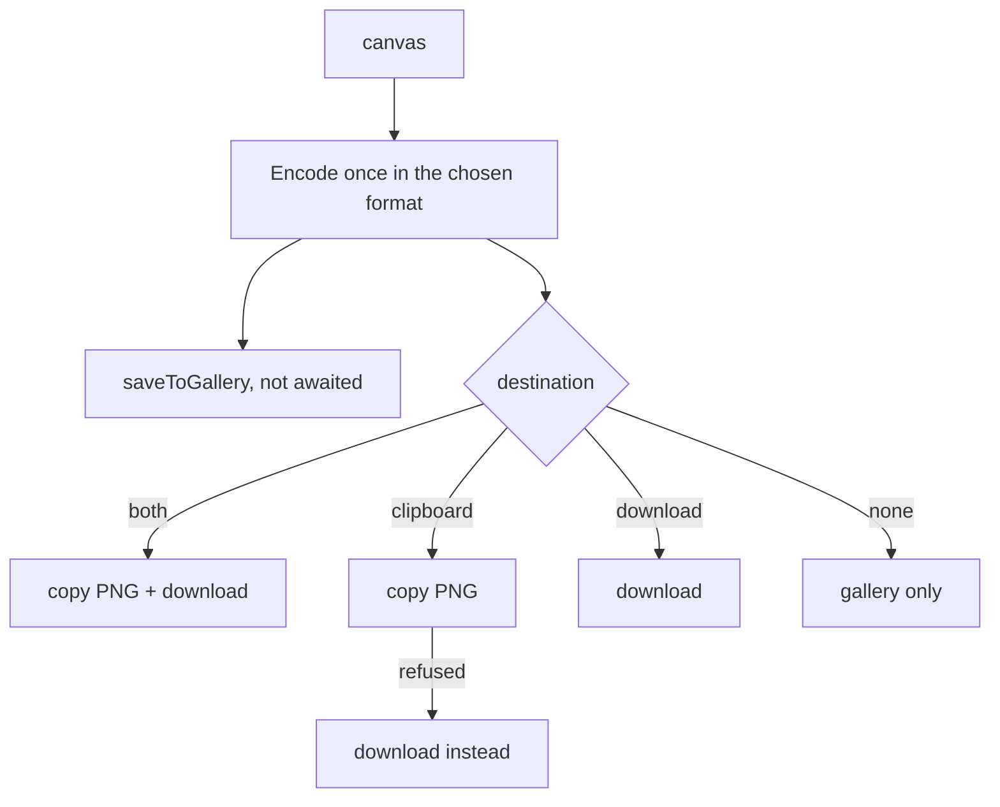

# Capture Engine

Every capture mode ends in the same place: a canvas or blob handed to the delivery layer. What differs is how the pixels are gathered. This document walks through each pipeline, the coordinate maths, and the safeguards that keep large captures from exhausting memory.

| Mode | Source of pixels | Module |
| :--- | :--- | :--- |
| Region, smart element | One viewport snapshot, cropped | `src/capture/region.js` |
| Visible area | One viewport snapshot | `src/capture/region.js` |
| Full page, horizontal (up to 12 tiles) | Repeated viewport snapshots of an unrolled page | `src/capture/fullpage.js` |
| Full page, horizontal (more than 12 tiles) | Frames from a tab capture stream | `offscreen.js` |

<br>

## 1. Device pixel ratio

`chrome.tabs.captureVisibleTab` returns an image at the display's native resolution. A 1280 × 800 CSS-pixel viewport on a 2× display produces a 2560 × 1600 image. All geometry the user interacts with is in CSS pixels, so every mapping multiplies by `window.devicePixelRatio`:

```js
const dpr = window.devicePixelRatio || 1;
const sx = Math.round(viewRect.left * dpr);
const sy = Math.round(viewRect.top * dpr);
const sw = Math.round(viewRect.width * dpr);
const sh = Math.round(viewRect.height * dpr);
ctx.drawImage(img, sx, sy, sw, sh, 0, 0, sw, sh);
```

Rules the engine follows:

- **Output is always in device pixels.** Nothing is downscaled to CSS size, so text stays sharp on high-density displays.
- **Round once, at the edge.** Tile origins use `Math.floor(logical * dpr)` and slice boundaries use `Math.round`, and the last row and column are snapped to the canvas edge. That removes the one-pixel seams that fractional ratios (1.25, 1.5) otherwise create.
- **Browser zoom is part of the ratio.** At 150% zoom on a 1× display `devicePixelRatio` is 1.5, and the same code path handles it.
- **Scrollbars are trimmed arithmetically.** The crop width is `min(image.width, clientWidth * dpr)`, which excludes a classic scrollbar without touching page styles.

<br>

## 2. Region capture



**Freeze frame.** When the capture UI opens it requests one viewport snapshot (`freezeFramePromise` in `ui.js`). The crop is taken from that frame, so the result matches what was on screen when selection began, even on pages with animation or video, and no second round trip is needed at pointer-up. If the frame is missing, the engine hides its UI and takes a live snapshot instead.

**Cursor.** `toggleCursor(true)` injects a temporary rule that hides the cursor for the duration of a live snapshot.

**Smart element capture** uses the same function. The rectangle simply comes from the element detector instead of a drag. See [ELEMENT_DETECTION.md](ELEMENT_DETECTION.md).

<br>

## 3. Visible area capture

1. `hideUiForCapture()` removes every extension surface from the frame.
2. One `capture-visible-tab` request, with a 4 second timeout so a stalled worker cannot hang the page.
3. `detectStandaloneMediaOrActiveBounds()` checks whether the tab is showing a bare image, video, SVG or canvas. If it is, the crop tightens to the media element so the result has no letterbox margins.
4. The canvas is filled white before drawing, so transparent regions do not turn black in JPG.
5. `deliverCanvas(type: "visible")`.

`MAX_CAPTURE_VISIBLE_TAB_CALLS_PER_SECOND` errors are retried with exponential backoff (600 ms, 1200 ms, 2400 ms) by `captureFrame()`.

<br>

## 4. Full page capture

### Why not scroll and snap

Calling `window.scrollTo()` in a loop fails on real sites:

- Single-page apps scroll an inner container, not the document.
- Sticky and fixed headers repeat in every frame.
- Scroll listeners trigger lazy loading, animations and layout shifts mid-capture.
- Scroll position is clamped at the bottom, so the last tile overlaps unpredictably.

SwiftSelect never scrolls. It **unrolls** the page and slides it with a transform.

### 4.1 Measure

`findInnerScrollContainer()` locates the element that actually scrolls. `measureFullContentHeight()` then returns one of three things: the natural height of a standalone image, the inner scroller's `scrollHeight` plus the fixed chrome around it, or the larger of the document and body scroll heights. `measureFullContentWidth()` does the same for the X axis.

If the content fits the viewport (within 5 px) the whole pipeline is skipped and a plain visible capture is used.

### 4.2 Unroll

`applyUnrollCSS()` injects one `<style data-swiftselect-unroll>` element that:

- sets `overflow: visible` on the root and on the inner scroller, and gives the scroller its full content height,
- hides scrollbars,
- applies `transform: translate3d(var(--scroll-left), var(--scroll-top), 0)` to the content.

Moving to a tile is then a single custom-property write in `setUnrollPosition()`. No scroll event fires, so the page's own scroll logic stays asleep.

### 4.3 Sticky and fixed element mitigation

`neutralizeStickyElements()` runs before the first tile.

1. **Read phase.** A `TreeWalker` visits every element (skipping `script`, `style`, `noscript` and SwiftSelect's own nodes) and collects those whose computed `position` is `fixed` or `sticky`, with their bounding rects. All reads happen first, which avoids layout thrashing.
2. **Write phase.** Each candidate becomes `position: absolute` with its width and height frozen and its `top` and `left` set to the document coordinates it currently occupies (relative to its offset parent). It then appears once, where the user saw it, instead of in every tile.
3. **Restore.** Original inline styles are recorded and put back by `restoreStickyElements()` on success, failure and abort.

Horizontal mode locks fixed sidebars to their current viewport position instead, so a fixed navigation rail stays at the left edge of the panorama.

### 4.4 Tile grid

`computeGridPoints(totalSize, viewportSize, overlap = 2)` produces tile origins for one axis:

```text
step   = viewportSize - 2          (2 CSS px overlap hides sub-pixel rounding)
points = 0, step, 2*step, ...  while < totalSize - viewportSize
last   = totalSize - viewportSize  (final tile is flush with the end)
```

The full grid is the product of the X and Y point lists. Horizontal mode uses a single Y point.

### 4.5 Two stitching paths



**Compositor path (most pages).** For each tile: set the unroll position, force layout, wait 60 ms for paint, call `captureFrame()`. These are lossless PNG snapshots straight from the compositor. Tiles are drawn so that each one contributes only the slice up to the next tile's origin, which makes the overlap irrelevant and the seams exact.

**Stream path (very long pages).** `captureVisibleTab` is rate limited, so dozens of tiles would take a long time. Instead:

1. The worker requests a stream id for the tab and ensures the offscreen document exists.
2. The offscreen document opens the stream with `getUserMedia` (`chromeMediaSource: "tab"`, cursor never) and wraps the track in `ImageCapture`.
3. For each tile it relays `update-unroll` to the content script, waits `frameInterval` (60 ms), then calls `grabFrame()`.
4. `FrameDetector` downsamples each frame to 10 × 10 pixels and compares it byte for byte with the previous one. An identical frame means the compositor has not repainted yet, so the grab is retried.
5. Progress is relayed to the page and to the toolbar badge.

### 4.6 Canvas limits

Chromium refuses canvases above 32,767 px on a side or 268,435,456 px in area, and `toBlob` returns `null` when either is exceeded.

| Path | Safeguard |
| :--- | :--- |
| Compositor | Chosen only when the projected canvas fits both limits. Anything larger is routed to the stream path |
| Stream | `MAX_CANVAS_DIM = 16384`, `MAX_CANVAS_AREA = 268435456`. A single `scaleRatio` is computed for both axes and applied with `ctx.scale`, so an oversized page is scaled down proportionally instead of failing |

### 4.7 Cleanup

Success, failure and <kbd>Esc</kbd> all run the same teardown: restore sticky elements, remove the unroll style, restore the scroll position, clear the cursor override, reset the badge and restore the toolbar button. The abort flag is checked between tiles, so cancelling is immediate.

<br>

## 5. Horizontal capture

Horizontal mode captures the band currently on screen across the full content width. It is built for wide tables, timelines and zoomed pages.

- If `measureFullContentWidth() <= innerWidth + 5`, nothing is unrolled and a visible capture is returned.
- Otherwise only the X axis is unrolled (`translate3d(var(--scroll-left), 0, 0)`), with a single Y tile.
- The output canvas is `contentWidth × innerHeight` in device pixels.

<br>

## 6. Memory-safe offscreen rendering

Stitching a long page touches a lot of pixels. The stream path is written to keep peak memory low and to keep the page responsive.

| Technique | Effect |
| :--- | :--- |
| Stitch in the offscreen document | The page's main thread and heap are not involved. A heavy web app keeps running |
| `ImageBitmap` frames | Frames come from `grabFrame()` as GPU-backed bitmaps. No intermediate data URL or base64 copy per tile |
| Close on draw | Frames wait as bitmaps only until stitching. Each one is closed the moment it has been drawn, and the stream tracks are stopped before encoding begins |
| `imageSmoothingEnabled = false` at 1:1 | Tiles are blitted without resampling when no scale-down is needed |
| Proportional clamp | One scale factor keeps the canvas inside Chromium's limits |
| Blob URL hand-off | The result returns as `blob:` URL. A data URL is added only when it is under 20 MB of text, to avoid large message copies |
| Direct download | `chrome.downloads.download` takes the extension blob URL as is, so the file is written without passing through the page |
| Idle teardown | The offscreen document closes after 30 s, releasing the stream and canvas |

In the page, intermediate canvases are local variables that go out of scope after `toBlob`, and object URLs are revoked on a timer.

<br>

## 7. Delivery

`src/capture/deliver.js` is the single fan-out point. `deliverCanvas(canvas, { type, flash, flashRect })` reads the cached settings and then:



| Setting | Values | Effect |
| :--- | :--- | :--- |
| `outputFormat` | `png`, `jpg`, `webp` | Encoding of the file and the gallery copy |
| `outputQuality` | 0.5 to 1.0 | Passed to `toBlob` for JPG and WebP. PNG ignores it |
| `outputDestination` | `both`, `clipboard`, `download`, `none` | Derived from the Auto-copy and Auto-download switches |
| `saveToGallery` | boolean | Store the capture in the gallery |
| `captureDelay` | 0, 3, 5 | Countdown before visible, full page and horizontal captures |
| `filenameTemplate` | string | Download name |

**Clipboard is always PNG.** The async clipboard API accepts only `image/png`, so a JPG or WebP capture is encoded a second time for the clipboard. If the page blocks the write (lost focus, permissions policy), the PNG goes to the offscreen document, which writes it from the extension origin.

**Downloads** try, in order: `chrome.downloads` with an extension blob URL (stream path), the downloads API directly (extension pages), an anchor click (ordinary pages), then `chrome.downloads` with a data URL (`file://` pages).

**Filenames** come from `buildFilename()`: tags are expanded, characters illegal on Windows are stripped, empty tags collapse cleanly, and the result is capped at 180 characters.

Full page and horizontal captures follow the same switches. A long capture with auto-copy only still downloads when the clipboard write fails.
