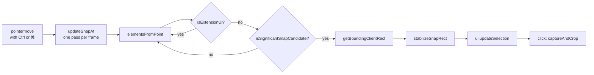

# Element Detection

Region selection has two ways to produce a rectangle: the user drags one, or holds <kbd>Ctrl</kbd> (<kbd>⌘</kbd> on macOS) and lets SwiftSelect snap to the element under the cursor. This document covers the snapping algorithm, how bounding boxes become capture rectangles, and how pointer hit testing keeps the extension's own UI out of the way.

All of it lives in `src/events.js`.

<br>

## 1. Pipeline



<br>

## 2. Triggering and throttling

`onPointerMove` checks the modifier on every event. With the modifier held and no drag in progress it calls `updateSnapAt(x, y)`.

`updateSnapAt` stores the latest pointer position and schedules one `requestAnimationFrame` callback. If a callback is already pending, the new position simply replaces the old one. Detection therefore runs at most once per frame and always uses the newest coordinates, however fast the mouse moves.

Releasing the modifier calls `clearSnapState()`, which cancels the pending frame, removes the `qs-snapping` class and clears the highlighted rectangle.

<br>

## 3. Candidate discovery

```js
const elements = document.elementsFromPoint(x, y);
```

`elementsFromPoint` returns every element stacked under the point, topmost first. `findSnapRect` walks that list and returns the bounding rectangle of the first element that is not extension UI and passes the significance test.

Walking the stack is what makes snapping feel right. The topmost node is often a transparent wrapper or an inline `span`. The first *significant* node below it is the card, image or control the user is actually pointing at.

The call is wrapped in `try/catch`, because some documents (certain XML and plugin documents) throw.

<br>

## 4. The significance test

`isSignificantSnapCandidate(el)` is a short series of cheap rejections followed by one decision. Geometry is checked before `getComputedStyle`, so most rejected candidates never pay for a style read.

| Step | Rule | Why |
| :--- | :--- | :--- |
| 1 | Reject if narrower or shorter than 36 px | Icons and glyphs are not capture targets |
| 2 | Reject if any edge lies outside the viewport (1 px tolerance) | The capture is a crop of the visible frame, so a partly hidden element cannot be captured whole |
| 3 | Reject `BODY` and `HTML` | That is what visible capture is for |
| 4 | Reject non-media elements covering more than 96% of the viewport in either axis | Page-sized wrappers |
| 5 | Reject `display: none`, `visibility: hidden`, `opacity: 0` | Invisible |
| 6 | **Accept** media: `IMG`, `VIDEO`, `SVG`, `CANVAS`, `IFRAME`, `EMBED`, `OBJECT` | Always meaningful |
| 7 | **Accept** interactive: `INPUT`, `TEXTAREA`, `SELECT`, `BUTTON`, `A` | Always meaningful |
| 8 | Large containers (over 300 × 300) with no border, background image or shadow: accept only with at least 10 characters of text | Stops empty layout boxes from winning |
| 9 | Otherwise accept if it has a background image, a non-transparent background colour, a visible border, a box shadow, or any text | Visual substance |

Media is exempt from step 4 so that a video or image filling the viewport can still be snapped.

<br>

## 5. Stabilisation

Raw detection flickers. Moving across a card passes over its title, its image and its padding, and each of those is significant on its own. `stabilizeSnapRect(next, x, y)` adds hysteresis:

- If the new rectangle is nearly identical to the current one (`isNearlySameRect`), keep the current object. Sub-pixel differences never restart the highlight animation.
- If the pointer is still inside the current rectangle and the current rectangle is more than **1.7 times** the area of the new one, keep the current one. The highlight stays on the card instead of diving into its children.
- Otherwise take the new rectangle.

To reach a child deliberately, move the pointer out of the parent and back in over the child, or simply drag a manual selection.

<br>

## 6. From bounding box to capture rectangle

`getBoundingClientRect()` returns viewport-relative CSS pixels, which is exactly the coordinate space of the frozen viewport frame. No scroll offset is added. The rectangle goes through three stages:

| Stage | Space | Operation |
| :--- | :--- | :--- |
| Highlight | CSS px, viewport | `ui.updateSelection(rect)` positions the selection box and the dimension HUD |
| Capture | CSS px, viewport | A click (a drag smaller than 5 × 5 px) calls `captureAndCrop(highlightedRect)` |
| Crop | Device px | Each edge is multiplied by `devicePixelRatio` and rounded |

Transforms are handled for free: the bounding rectangle of a rotated or scaled element is its axis-aligned box on screen, which is the region a screenshot should contain.

Rounded corners and shadows that extend outside the box are not included. The capture is the box itself.

<br>

## 7. Mouse hit testing

Three separate hit tests run during a session.

### 7.1 Is the pointer on SwiftSelect's own UI?

`isEventOnUi(e)` protects the toolbar, status pill and dialogs from being treated as page content. The UI lives in Shadow DOM, where `e.target` is retargeted to the host, so the test walks `e.composedPath()` and returns true as soon as one node is a known host object (`guideHost`, `statusHost`, `keyGuideHost`, `countdownHost`, the modal hosts), has a known host id (`qs-guide-host`, `swiftselect-annotate-root` and others), or carries a `qs-` UI class (`qs-guide`, `qs-status`, `qs-modal`, `qs-tooltip`, `qs-annotate` and so on). A pointer-down that passes this test never starts a selection.

`isExtensionUi(candidate)` is the same idea for the detector: any element inside a SwiftSelect host, or the host itself, is skipped while walking `elementsFromPoint`.

### 7.2 Is this a click or a drag?

`onPointerDown` records the origin. `onPointerUp` measures the final rectangle.

- Smaller than 5 × 5 px with a highlighted element: capture that element.
- Smaller than 5 × 5 px with nothing highlighted: the session is cancelled and a brief "Canceled" status is shown.
- Larger: capture the dragged rectangle.

While dragging, <kbd>Shift</kbd> constrains the box to a square and <kbd>Space</kbd> switches from resizing to moving, keeping the size and translating the origin with the pointer.

### 7.3 Why page handlers do not fire

`addListeners()` attaches everything to the document in the capture phase. The pointer handlers call `preventDefault`, `stopPropagation` and `stopImmediatePropagation` themselves, and `preventAll` does the same for `click`, `dblclick` and `contextmenu` unless the event is on SwiftSelect's own UI. The page never sees the drag, so links are not followed and text is not selected. Scroll, wheel and resize are observed too, so the overlay stays aligned. `removeListeners()` detaches everything on capture, cancel and navigation.

<br>

## 8. Limits

| Case | Behaviour |
| :--- | :--- |
| Cross-origin iframes | The `IFRAME` element itself is a candidate and snaps as one box. Elements inside it are not reachable from the top document |
| Closed shadow roots | The host element is the candidate |
| Elements larger than the viewport | Rejected by rule 2. Use full page capture |
| `pointer-events: none` elements | Not returned by `elementsFromPoint`, so the element beneath is used |
