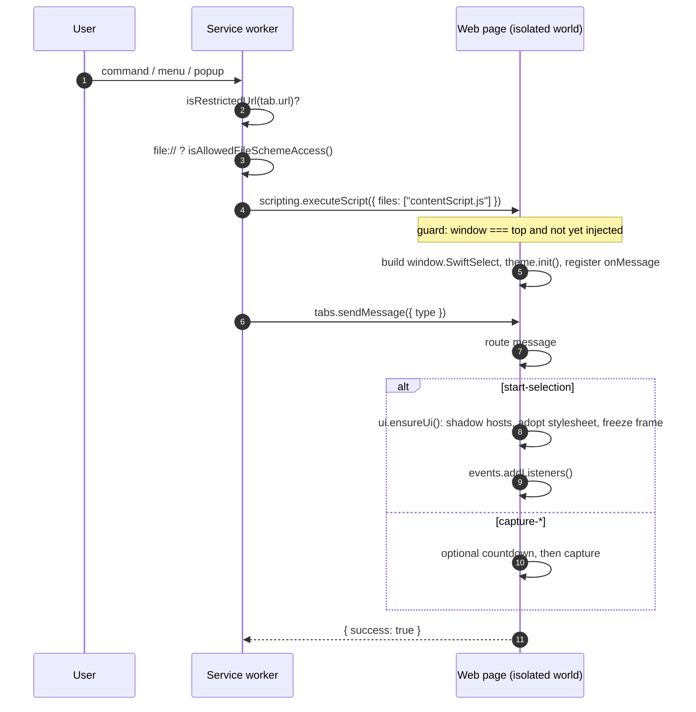

# Loading Sequence

What happens between a key press and an interactive capture UI, why the content script is a single pre-built file, and how frames are handled.

<br>

## 1. Entry points

| Trigger | Handler in `background.js` | Result |
| :--- | :--- | :--- |
| Keyboard command | `chrome.commands.onCommand` → `handleCommand()` | `injectAndStart(tab, type)` |
| Context menu item | `chrome.contextMenus.onClicked` → `handleContextMenuClick()` | `injectAndStart(tab, type)` or a settings write |
| Toolbar icon, `actionClick = "region"` | `chrome.action.onClicked` | `injectAndStart(tab, "start-selection")` |
| Toolbar icon, `actionClick = "menu"` | none, Chrome opens `popup.html` | Popup sends `run-capture` |
| Gallery or Settings capture buttons | `runtime.onMessage` (`run-capture`) | `findCaptureTarget()` → `injectAndStart()` |

Every path converges on `injectAndStart(tab, messageType)`.

<br>

## 2. The sequence



### Step 1: URL validation

`isRestrictedUrl()` rejects pages Chrome does not let extensions script:

`chrome://`, `edge://`, `about:`, `chrome-extension://`, `view-source:`, `devtools://`, and both Chrome Web Store hosts.

The same check runs continuously in `updateTabBadge()`, which is why the toolbar icon already shows the "protected page" popup on those tabs before anything is clicked.

### Step 2: File access

For `file://` URLs the worker calls `chrome.extension.isAllowedFileSchemeAccess()`. Without the permission it sets an amber `FILE` badge and stops. The popup for that tab explains how to enable access.

### Step 3: Injection

```js
await chrome.scripting.executeScript({ target: { tabId }, files: ["contentScript.js"] });
```

The script is injected on demand, never declared under `content_scripts`. Pages that are never captured never run a line of SwiftSelect code.

Injection happens on every activation. The bundle makes that safe with an idempotency guard:

```js
if (window === window.top && !window.__swiftSelectInjected_v2) {
  window.__swiftSelectInjected_v2 = true;
  // set up once
}
```

A second injection evaluates the bundle, fails the guard and does nothing. The listener registered the first time receives the new message.

### Step 4: Synchronous bootstrap

Inside the guard, in one synchronous run:

1. `window.SwiftSelect = { theme, ui, events, capture }`
2. `theme.init()`
3. `chrome.runtime.onMessage.addListener(...)`

Registering the listener synchronously matters. `executeScript` resolves as soon as the script has run, and the worker sends its message immediately afterwards. A listener registered after an `await` could miss it.

### Step 5: Routing

| Message | Action |
| :--- | :--- |
| `start-selection` | `ui.ensureUi()` then `events.addListeners()`. Ignored while the editor is open |
| `capture-visible`, `capture-download` | `afterDelay()` → `region.handleCaptureVisible()` |
| `capture-full` | `afterDelay()` → `fullpage.handleCaptureFullPage()` |
| `capture-horizontal` | `afterDelay()` → `fullpage.handleCaptureHorizontal()` |
| `capture-timer` | `region.handleTimedCapture(delay or 3)` |
| `show-help-modal` | `ui.showShortcutsHelpModal()` |
| `show-settings-modal` | Opens the Settings tab |
| `fullpage-progress` | Updates the progress label and badge |
| `fullpage-action` | `unroll-page`, `update-unroll`, `restore-unroll` |

`afterDelay()` reads `captureDelay`. A non-zero value shows the countdown card first. Region selection is interactive and is never delayed.

### Step 6: UI materialisation

`ui.ensureUi()`:

1. `loadStyles()` builds one constructable `CSSStyleSheet` from the bundled CSS text.
2. `makeShadowOverlay()` creates each host (`overlay`, `guide`, `status`, `highlighter`, HUD) as a fixed, `pointer-events: none`, initially hidden `div` with an open shadow root.
3. Each root adopts the shared sheet through `adoptedStyleSheets`.
4. The first viewport snapshot is requested for the freeze frame.
5. `theme.applyTheme()` picks light or dark glass per element.
6. Hosts are revealed.

Hosts start at `display: none` and their inner element at `opacity: 0` until the sheet is attached, so there is never a flash of unstyled UI.

### Step 7: Cleanup

Capture, <kbd>Esc</kbd> and navigation all run `events.cleanup()` and `ui.cleanup()`: listeners removed, hosts detached, crosshair cursor restored, freeze frame released. Safety listeners on `beforeunload` and `visibilitychange` remove any overlay that would otherwise outlive the session.

<br>

## 3. CSP strategy

A content script runs in an isolated world, but anything it adds to the DOM is subject to the **page's** Content Security Policy. Strict policies (GitHub, YouTube, Google apps, banking sites) block the obvious ways of loading extension code and styles. SwiftSelect avoids each one.

| Naive approach | Blocked by | What SwiftSelect does |
| :--- | :--- | :--- |
| `import()` of `chrome-extension://` modules from the page | `script-src` | One IIFE bundle (`esbuild --bundle --format=iife`). No dynamic import, no module graph at runtime |
| `<link rel="stylesheet" href="chrome-extension://...">` | `style-src` | CSS is compiled into the bundle as a string (`--loader:.css=text`) |
| `fetch("chrome-extension://.../styles.css")` | `connect-src` | Not needed, the text is already in memory |
| Global `<style>` rules in the document | Collisions with page CSS in both directions | Constructable stylesheets (`new CSSStyleSheet()` + `adoptedStyleSheets`) scoped to shadow roots. No style element is added to the page for the capture UI |
| Page CSS leaking into the UI | n/a | Every surface is in its own shadow root and begins with `all: initial` |
| Fetching an extension `blob:` URL from the page | `connect-src`, origin | `fetch-blob-url` asks the worker to resolve it |
| `navigator.clipboard.write` denied | Permissions Policy, lost focus | `write-image-to-clipboard` writes from the offscreen document |
| `<a download>` blocked or unreliable on `file://` | page context | `download-file` uses `chrome.downloads` |

The annotation editor is the one surface that renders in the light DOM (it needs a full-screen canvas and a native colour input). Its container starts with `all: initial`, carries the highest z-index, and receives the stylesheet text in a style element that the content script creates from its isolated world, scoped by `qs-` prefixed class names.

Extension pages (`gallery.html`, `settings.html`, `popup.html`, `annotate.html`) run under the default Manifest V3 extension CSP. They contain no inline scripts and load only local files.

<br>

## 4. Frames

**The content script runs in the top frame only.** `executeScript` is called without `allFrames`, and the guard checks `window === window.top`.

This is deliberate:

- Captures are taken by the browser compositor (`captureVisibleTab`, `tabCapture`), which renders every frame, including cross-origin ones, into one image. No code needs to run inside an iframe to photograph it.
- One overlay in the top document covers the entire viewport. An overlay per frame would produce nested toolbars and split selections.
- Cross-origin frames stay untouched, so SwiftSelect never reads or modifies third-party embedded content.

| Scenario | Behaviour |
| :--- | :--- |
| Region drawn across an iframe | Captured as displayed. The pixels come from the compositor |
| Smart snap over an iframe | The `IFRAME` element is the candidate. Its inner elements are not inspected |
| Full page capture with a scrolling iframe | The iframe appears as it is currently scrolled. Its inner content is not unrolled |
| Page whose main content is one full-size iframe | Full page capture yields one viewport. Open the frame's URL in its own tab to capture all of it |
| Theme sampling over a cross-origin frame | `elementsFromPoint` returns the iframe element. Sampling falls back to the last tab screenshot or the surrounding surface |

<br>

## 5. Extension pages

Pages load in a different order from the content script because they have direct access to extension APIs.

```text
<head>
  src/pageTheme.js   classic, blocking: sets html[data-theme] before first paint
  pages.css
<body>
  markup with <i data-icon> placeholders
  <script type="module">   gallery.js | options.js | popup.js
      hydrateIcons() → getSettings() → render → subscribe to storage and gallery changes
```

`annotate.html` loads `annotatePage.js`, a bundle. The editor imports CSS as text, which native ES modules cannot do, so that page is built the same way as the content script.

<br>

## 6. Build outputs

| Output | Source entry | Command |
| :--- | :--- | :--- |
| `src/styles.min.css` | `styles.css` | `npm run build:css` |
| `contentScript.js` | `src/contentScript.js` | `npm run build:content` |
| `annotatePage.js` | `src/annotatePage.js` | `npm run build:annotate` |

`npm run build` runs all three in order. The CSS step must come first, because both bundles embed its output.
