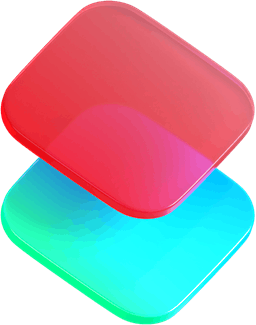
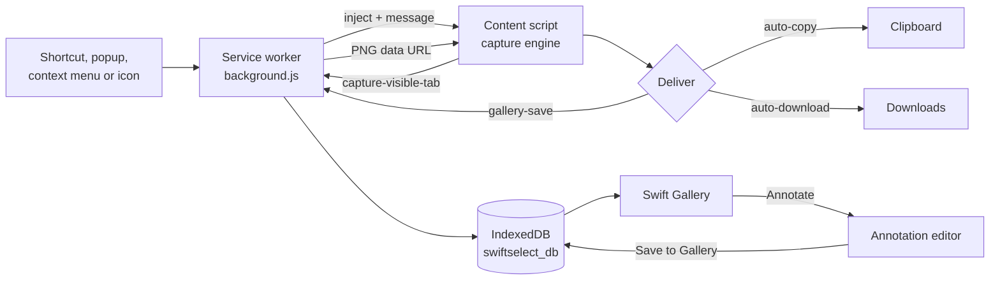

<div align="center">

<br>



# SwiftSelect

Capture, copy, annotate and keep every screenshot. One motion, zero friction.

<br>

[](https://chromewebstore.google.com/detail/swiftselect-capture-copy/aboceojignbeaclebdpjjgkocmdldoec)

A fast, dependency-free screenshot extension for Chrome. Select a region, grab the viewport, or stitch an entire page. Each capture lands on your clipboard, in your Downloads folder and in a local gallery, according to the settings you choose.

</div>

<br>

---

<br>
<div align="center">
  
</div>

<br>

## Contents

- [Feature matrix](#feature-matrix)
- [How a capture flows](#how-a-capture-flows)
- [Shortcut cheat sheet](#shortcut-cheat-sheet)
- [Gallery](#gallery)
- [Annotation editor](#annotation-editor)
- [Settings](#settings)
- [Installation](#installation)
- [Architecture at a glance](#architecture-at-a-glance)
- [Development](#development)
- [Permissions](#permissions)
- [Documentation map](#documentation-map)

<br>

## Feature matrix

### Capture modes

| Mode | Trigger | What you get | Engine |
| :--- | :--- | :--- | :--- |
| Region | <kbd>Alt</kbd>+<kbd>X</kbd>, then drag | The exact rectangle you drew | Frozen viewport frame, cropped at device pixel ratio |
| Smart element | Hold <kbd>Ctrl</kbd>/<kbd>⌘</kbd>, hover, click | The image, card or control under the cursor | `elementsFromPoint` hit test with a significance filter |
| Visible area | <kbd>Alt</kbd>+<kbd>S</kbd> | The viewport, scrollbars trimmed | One compositor snapshot |
| Full page | <kbd>Alt</kbd>+<kbd>F</kbd> | The whole document, top to bottom | Scroll unroll plus 2D tile stitching |
| Horizontal | <kbd>Alt</kbd>+<kbd>H</kbd> | The current band across the full content width | Horizontal unroll plus tile stitching |
| Delayed | Popup, context menu, <kbd>T</kbd> | Visible area after a countdown | Countdown card, then visible capture |

### Output

| Capability | Detail |
| :--- | :--- |
| Formats | PNG (lossless), JPG, WebP, with a 0.50 to 1.00 quality control for JPG and WebP |
| Auto-copy | Clipboard always receives PNG, with an offscreen fallback when the page blocks clipboard access |
| Auto-download | Native download with a filename template: `{date}` `{time}` `{title}` `{url}` `{type}`. Full page and horizontal captures are always saved as a file, whatever this switch says, so the status pill offers no Download button for them |
| Gallery | Every capture stored locally in IndexedDB with a thumbnail, dimensions, source URL and size |
| Delay timer | Instant, 3 seconds or 5 seconds before visible, full page and horizontal captures |

### Surfaces

| Surface | File | Purpose |
| :--- | :--- | :--- |
| Toolbar icon | `popup.html` | One click starts a region capture. On protected pages it explains why and offers to capture your last tab. The quick menu is an option in Settings |
| Capture toolbar | injected by `contentScript.js` | Floating in-page pill with every mode and live key hints |
| Swift Gallery | `gallery.html` | Full-tab dashboard: search, filter, preview, copy, download, annotate, delete |
| Settings | `gallery.html#settings` | A view of the Gallery, opened from its sidebar, the toolbar menu or Chrome's Options. Saves as you go |
| Annotation editor | in-page, or `annotate.html` | Ten tools, undo and redo, copy, download, save to gallery |

<br>

## How a capture flows



Very long pages take a second route: when a page needs more than twelve viewport tiles, the stitching moves into an offscreen document that reads frames from a tab capture stream. [CAPTURE_ENGINE.md](CAPTURE_ENGINE.md) covers both paths.

<br>

## Shortcut cheat sheet

### Global (configurable at `chrome://extensions/shortcuts`)

| Shortcut | Action |
| :--- | :--- |
| <kbd>Alt</kbd>+<kbd>X</kbd> | Start region selection and open the capture toolbar |
| <kbd>Alt</kbd>+<kbd>S</kbd> | Capture the visible area |
| <kbd>Alt</kbd>+<kbd>H</kbd> | Capture the horizontal view |
| <kbd>Alt</kbd>+<kbd>F</kbd> | Capture the full page |
| unassigned | Delayed capture |

On macOS the defaults use <kbd>Ctrl</kbd> in place of <kbd>Alt</kbd>. Chrome may leave a default unbound if another extension already holds it. The Settings page always shows the bindings Chrome actually registered.

### While the capture toolbar is open

The capture toolbar can be **moved**: press anywhere on it and drag. A press that does not move is still a click. The spot is remembered across pages; double-click the empty glass to send it home.

An image opened on its own in a tab is captured **without Chrome's grey margins** in every mode: Visible, Full page, Horizontal and Annotate. Full page measures the image as displayed, so a picture fitted to the window is captured once instead of being scrolled into a half-black stitch.

Single-key shortcuts are **off by default** so typing on a page never triggers a capture. Turn them on in Settings › Shortcuts. The modifiers (snap, square, move) and <kbd>Esc</kbd> always work.

| Key | Action |
| :--- | :--- |
| <kbd>V</kbd> or <kbd>S</kbd> | Capture visible area |
| <kbd>F</kbd> | Capture full page |
| <kbd>H</kbd> | Capture horizontal view |
| <kbd>T</kbd> | Delayed capture |
| <kbd>A</kbd> | Annotate the current view |
| <kbd>C</kbd> | Copy the colour under the cursor |
| <kbd>G</kbd> | Open the gallery |
| <kbd>,</kbd> or <kbd>O</kbd> | Open Settings |
| <kbd>Ctrl</kbd>/<kbd>⌘</kbd> + hover | Snap to the element under the cursor |
| <kbd>Shift</kbd> while dragging | Constrain to a square |
| <kbd>Space</kbd> while dragging | Move the selection |
| <kbd>Esc</kbd> | Cancel |

### In the annotation editor

Editor shortcuts are **off by default** too (Settings › Shortcuts). <kbd>Esc</kbd>, <kbd>Enter</kbd> and <kbd>Delete</kbd> always work; every other key below needs the switch.

| Key | Action |
| :--- | :--- |
| <kbd>V</kbd> | Select and move |
| <kbd>P</kbd> / <kbd>H</kbd> | Pen / Highlighter |
| <kbd>A</kbd> / <kbd>R</kbd> / <kbd>O</kbd> | Arrow / Rectangle / Ellipse |
| <kbd>S</kbd> / <kbd>B</kbd> / <kbd>T</kbd> | Step counter / Blur / Text |
| <kbd>C</kbd> | Crop (<kbd>Enter</kbd> applies) |
| <kbd>F</kbd> | Toggle fill |
| <kbd>[</kbd> / <kbd>]</kbd> | Thinner / thicker stroke |
| <kbd>Shift</kbd> while drawing | Square, circle, 45° arrow, straight stroke |
| <kbd>Ctrl</kbd>+<kbd>Z</kbd> / <kbd>Ctrl</kbd>+<kbd>Y</kbd> | Undo / Redo (<kbd>Ctrl</kbd>+<kbd>Shift</kbd>+<kbd>Z</kbd> also redoes) |
| <kbd>Ctrl</kbd>+<kbd>C</kbd> / <kbd>Ctrl</kbd>+<kbd>S</kbd> / <kbd>Ctrl</kbd>+<kbd>G</kbd> | Copy / Download / Save to gallery |
| <kbd>Delete</kbd> | Remove the selected shape |
| <kbd>←</kbd> <kbd>↑</kbd> <kbd>→</kbd> <kbd>↓</kbd> | Nudge the selected shape 1 px (10 px with <kbd>Shift</kbd>). Always on |
| <kbd>Ctrl</kbd>+<kbd>D</kbd> | Duplicate the selected shape |
| <kbd>Esc</kbd> | Close |

### In the gallery

| Key | Action |
| :--- | :--- |
| <kbd>/</kbd> or <kbd>Ctrl</kbd>/<kbd>⌘</kbd>+<kbd>K</kbd> | Focus search |
| <kbd>←</kbd> <kbd>→</kbd> | Previous and next capture in the preview |
| <kbd>Ctrl</kbd>/<kbd>⌘</kbd>+<kbd>A</kbd> | Select every visible capture |
| <kbd>Delete</kbd> | Move the selection to Trash (delete forever inside Trash) |
| <kbd>Ctrl</kbd>/<kbd>⌘</kbd>+<kbd>V</kbd> | Add an image from the clipboard |
| <kbd>Esc</kbd> | Close the preview, clear the selection or clear the search |

<br>

## Gallery

`gallery.html` is a full-tab dashboard over the local capture store.

- **Library**: All, Favorites, Recent (last 24 hours), Earlier, one view per capture type, and Trash, each with a live count.
- **Date groups**: Today, Yesterday, Previous 7 days, Previous 30 days, then by month.
- **Favorites**: star a capture to keep it. Favorites are never auto-deleted.
- **Trash**: deleting is reversible. Captures wait in Trash for 7 or 30 days, with Restore, Restore all, Delete forever and Empty Trash.
- **Drag and drop**: drag a capture (or a whole selection) onto the Trash or Favorites dock that rises from the bottom, or onto Trash and Favorites in the sidebar. Drag a single capture out of the browser to drop it as a file on the desktop or into another app.
- **Selection**: <kbd>Ctrl</kbd>/<kbd>⌘</kbd>-click, <kbd>Shift</kbd>-click for a range, or the check circle on each card. A bulk bar offers Favorite, Download and Move to Trash.
- **Rename**: double-click a title.
- **Import**: drop image files from the desktop onto the gallery, or paste an image, to keep it alongside your captures. Imports are labelled Imported.
- **Guided drag**: while a capture is dragged, the other cards dim, a hint names the targets and the Trash zone pulses with its lid tipping until the pointer is over it.
- **Auto-delete**: captures older than *three months* move to Trash by default (favorites are never touched). Choose a week, a month or *Keep forever* instead.
- **Search** across title, URL, type, format and dimensions.
- **Grid and list views**, remembered between visits.
- **Card actions**: copy to clipboard, download, annotate, move to Trash, each with undo where it matters.
- **Preview** with fit and actual-size modes, previous and next, favorite and delete.
- **Live**: captures taken in other tabs appear without a reload.

Captures never leave the device. They live in the extension's own IndexedDB database and are removed with the extension.

<br>

## Annotation editor

Open it from the capture status pill, with <kbd>A</kbd> in the capture toolbar, or from any gallery card.

| Tool | Behaviour |
| :--- | :--- |
| Select and move | Bounding handles, drag, resize, <kbd>Delete</kbd> |
| Pen | Quadratic Bézier smoothing, stylus pressure when available and speed-simulated pressure otherwise |
| Highlighter | Translucent multiply stroke on light pages, screen blend on dark pages |
| Arrow | Solid geometric head, angle and length snapping with <kbd>Shift</kbd> |
| Rectangle and Ellipse | Stroke-proportional corner rounding, optional tinted fill |
| Step counter | Auto-incrementing numbered badges |
| Blur / Redact | Adaptive mosaic, or a solid bar with fill on. Redactions ignore the opacity control and are never translucent |
| Text | Inline editor, optional background pill with automatic contrast |
| Crop | Free, 16:9, 4:3, 1:1, 3:2, 9:16, eight drag handles |

The toolbar can be dragged anywhere by its grip and resets on double-click. Move, resize, restyle, delete, clear and crop are all undoable.

- **One style control**: the bar carries a single chip (colour disc, line weights, caret) that previews the current colour, thickness and fill. It opens a panel with the palette and a custom colour, Outline or Filled (Mosaic or Solid for redaction, Plain or Pill for text), four size presets plus a slider, and opacity, with a live preview. The panel only shows what applies to the current tool or selected shape, stays open while you switch tools, and follows the theme.
- **Per-tool styles**: Pen and shapes share one size and opacity (7 px, 100%); the Highlighter keeps its own (24 px, 45%). What the panel shows is exactly what the next stroke draws.
- **Size keys**: <kbd>[</kbd> and <kbd>]</kbd> step through the presets.
- **Live preview**: the panel draws a miniature of exactly what the canvas will draw (dashes, arrow heads, fill, typeface, mosaic or solid redaction), so every option shows its effect before you use it.
- **Delete in one click**: the trash button deletes the selected shape, or clears everything when nothing is selected. Both are undoable.
- **Line style** for pen, arrow, rectangle and ellipse: *solid*, *dashed* or *dotted*, remembered per tool.
- **Arrow heads**: at the end, at both ends, or a plain line.
- **Text**: four typefaces (Sans, Serif, Mono, Handwriting), **bold** and *italic*, plain or on a pill. The size readout shows the real font size.
- **Selection**: a crisp frame with rounded-square handles that stay the same size on screen at any zoom; pens and step counters show a frame too. Picking a drawing tool puts the selection down.
- **Brush cursor**: with Pen or Highlighter active the cursor is a ring (or bar) the size of the stroke at the current zoom.
- **Honest cursors**: the cursor only shows move or resize where a press would actually move or resize, and a dashed outline marks the shape under the pointer in Select.
- **Nudge and duplicate**: arrow keys move the selection; <kbd>Ctrl</kbd>+<kbd>D</kbd> copies it.

<br>

## Settings

Settings are a view inside the Gallery (sidebar › Settings, the gear in the top bar, or right-click the toolbar icon › Settings). `settings.html` and Chrome's **Options** link forward there, keeping a section anchor such as `#shortcuts`. Every change saves immediately, and the save state sits in the Gallery's top bar so it is always in view.

| Group | Options |
| :--- | :--- |
| General | Language, Theme (System, Light, Dark), toolbar icon click (region capture by default, or the quick menu) |
| Capture and export | Format, quality, auto-copy, auto-download, shutter flash, delay timer, filename template |
| Gallery and storage | Keep captures in the gallery, auto-delete after a week, month or three months, how long Trash keeps items, storage used, Empty Trash |
| Shortcuts | Live table of Chrome's global shortcuts, opt-in switches for capture toolbar and editor shortcuts |

<br>

## Installation

### Chrome Web Store (recommended)

<a href="https://chromewebstore.google.com/detail/swiftselect-capture-copy/aboceojignbeaclebdpjjgkocmdldoec">
  
</a>

### From Releases

1. Download the latest `.zip` from the [Releases](https://github.com/arsalan06106/SwiftSelect-capture-copy-download-screenshots/releases) page.
2. Extract it to a permanent folder.
3. Open `chrome://extensions/` and enable Developer mode.
4. Click Load unpacked and select the extracted folder.
5. Pin SwiftSelect from the extensions menu.

### From source

```bash
git clone https://github.com/arsalan06106/SwiftSelect-capture-copy-download-screenshots.git
```

The repository ships with its bundles already built, so the folder loads as is: open `chrome://extensions/`, enable Developer mode, click Load unpacked and select the cloned directory.

<br>

## Architecture at a glance

```text
┌──────────────────────────── Chrome ─────────────────────────────┐
│                                                                 │
│  Service worker (background.js)                                 │
│  ├─ commands, context menus, toolbar action                     │
│  ├─ captureVisibleTab, downloads, offscreen lifecycle           │
│  └─ gallery ingest ──────────────► IndexedDB swiftselect_db     │
│        ▲            ▲                         ▲                 │
│        │ messages   │ messages                │ direct          │
│        ▼            ▼                         │                 │
│  Content script     Offscreen document   Extension pages        │
│  contentScript.js   offscreen.js         gallery / settings /   │
│  (bundled src/*)    tab stream stitch,   popup / annotate       │
│  UI, capture,       clipboard fallback                          │
│  annotation                                                     │
└─────────────────────────────────────────────────────────────────┘
```

```text
SwiftSelect/
├── manifest.json            MV3 manifest
├── background.js            Service worker (ES module)
├── contentScript.js         BUILT: in-page bundle of src/contentScript.js
├── annotatePage.js          BUILT: standalone editor bundle of src/annotatePage.js
├── offscreen.html / .js     Offscreen document: tab stream stitching, clipboard
├── popup.html / popup.js    Toolbar popup: protected-page notice, quick menu, recent captures
├── gallery.html / gallery.js   Swift Gallery dashboard
├── settings.html            Forwards to gallery.html#settings
├── options.js               Settings view controller (mounted by the Gallery)
├── annotate.html            Shell for the standalone editor
├── options.html             Redirect to settings.html (kept for old links)
├── pages.css                Liquid Glass design system for extension pages
├── styles.css               In-page capture UI styles (bundled into contentScript.js)
├── src/
│   ├── contentScript.js     Content entry: namespace, message router, delay
│   ├── annotatePage.js      Standalone editor entry
│   ├── settings.js          Settings schema, normalisation, filename template
│   ├── storage.js           IndexedDB gallery engine
│   ├── pageKit.js           Page toolkit: icons, pill, toast, dialog, locale
│   ├── pageTheme.js         Pre-paint theme bootstrap for pages
│   ├── ui.js                Shadow DOM hosts, toolbar, status pill, tooltips
│   ├── events.js            Pointer and keyboard handling, element snapping
│   ├── theme.js             Adaptive in-page theming
│   └── capture/
│       ├── region.js        Region and visible capture
│       ├── fullpage.js      Unroll, sticky mitigation, tile stitching
│       ├── deliver.js       Clipboard, download and gallery fan-out
│       ├── download.js      Download strategies
│       ├── annotate.js      Annotation editor
│       └── utils.js         Shared helpers and cached settings
├── menu.html / menu.js      Standalone design prototype (not loaded by the extension)
└── icons/
```

<br>

## Development

There are no runtime dependencies. The only tool is esbuild, fetched on demand by `npx`.

```bash
npm run build     # styles.css -> src/styles.min.css, then both bundles
npm run check     # syntax check of every unbundled script
```

| Edit | Then |
| :--- | :--- |
| Anything under `src/` used in the page, or `styles.css` | `npm run build`, reload the extension |
| `background.js`, `offscreen.js`, `popup.js`, `gallery.js`, `options.js`, `pages.css`, any `.html` | Reload the extension |
| `src/settings.js`, `src/storage.js` | `npm run build` (both are also bundled), reload |

`contentScript.js` and `annotatePage.js` are build outputs. Edit their sources, never the bundles.

<br>

## Permissions

| Permission | Reason |
| :--- | :--- |
| `activeTab`, `scripting` | Inject the capture UI into the tab you invoke it on |
| `tabs` | Read the active tab's URL and title, route captures, focus the gallery |
| `<all_urls>` (host) | `captureVisibleTab` and injection on any page you choose to capture |
| `tabCapture`, `offscreen` | Stream-based stitching for very long pages, and the clipboard fallback |
| `clipboardWrite` | Copy screenshots |
| `downloads` | Save files with a chosen filename |
| `storage` | Preferences |
| `unlimitedStorage` | Let the gallery hold large full-page captures without hitting the default quota |
| `contextMenus` | Right-click capture and quick preference menus |

SwiftSelect makes no network requests and collects nothing.

<br>

## Documentation map

| Document | Read it for |
| :--- | :--- |
| [ARCHITECTURE.md](ARCHITECTURE.md) | Contexts, lifecycles, message contracts, state ownership |
| [CAPTURE_ENGINE.md](CAPTURE_ENGINE.md) | Stitching, device pixel ratio, sticky mitigation, memory safety |
| [THEME_SYSTEM.md](THEME_SYSTEM.md) | The Liquid Glass material, design rules, theme switching |
| [ELEMENT_DETECTION.md](ELEMENT_DETECTION.md) | Region snapping, bounding boxes, hit testing |
| [LOADING_SEQUENCE.md](LOADING_SEQUENCE.md) | Injection order, CSP strategy, iframes |
| [QUICK_REFERENCE.md](QUICK_REFERENCE.md) | Commands, messages, payloads, storage schemas |

<br>

## Contributing

Found an anomaly or have a feature idea? [Open an issue](https://github.com/arsalan06106/SwiftSelect-capture-copy-download-screenshots/issues). Pull requests are welcome.

<br>

## License

[MIT](LICENSE.txt) © 2026 [arsalan06106](https://github.com/arsalan06106)

<br>

---

<div align="center">

<br>

Built by <a href="https://github.com/arsalan06106">@arsalan06106</a>

If SwiftSelect saves you time, consider leaving a ★ on the repository.

<br>

</div>
