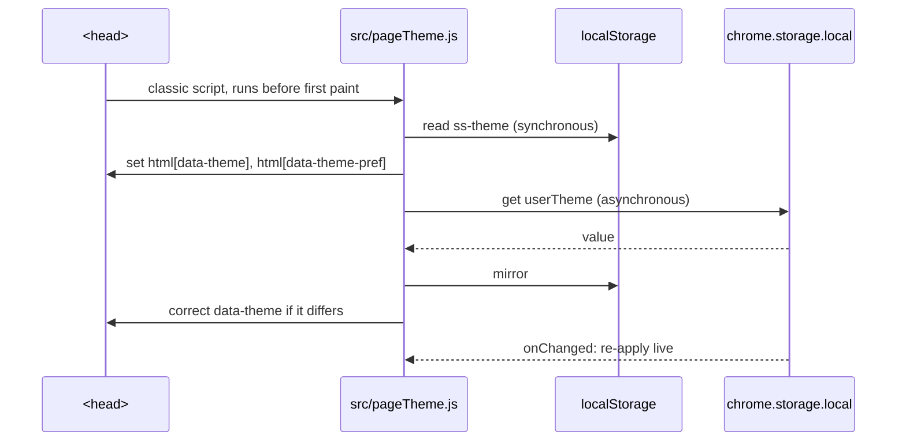

# Theme System

SwiftSelect has one material, Liquid Glass, defined once in `styles.css` for the capture toolbar. The extension pages (`pages.css`) reuse that definition exactly: the same variables, the same tint steps and the same reflection stacks. There is no second glass.

| Layer | Stylesheet | Where it renders | Tone decided by |
| :--- | :--- | :--- | :--- |
| In-page capture UI | `styles.css` (bundled as text) | Shadow DOM on top of arbitrary websites | User preference, then the pixels underneath |
| Extension pages | `pages.css` | Gallery, Settings, popup, standalone editor shell | User preference, then the OS |

The preference is a single value, `userTheme`, in `chrome.storage.local`.

| Value | Extension pages | In-page UI |
| :--- | :--- | :--- |
| `system` (default) | Follows `prefers-color-scheme` | Glass, tone sampled from the page behind each element |
| `light` | Light | Glass, forced light |
| `dark` | Dark | Glass, forced dark |

`glass`, the 1.x name for the adaptive default, is read as `system`. `standard`, the flat 1.x palette, is still honoured by the in-page UI if found in storage and is migrated to `system` on update.

<br>

## 1. The material

### Variables

Nine variables describe the glass. Everything else is derived from them.

| Variable | Light | Dark | Role |
| :--- | :--- | :--- | :--- |
| `--c-glass` | `#bbbbbc` | `#bbbbbc` | The glass body. Always mixed with transparency, never used solid |
| `--c-light` | `#fff` | `#fff` | Colour of highlights |
| `--c-dark` | `#000` | `#000` | Colour of shadows |
| `--c-content` | `#1b1c2a` | `#ececf2` | Text and icons |
| `--c-action` | `#0052f5` | `#03d5ff` | Focus rings. Used nowhere else on the pages |
| `--c-bg` | `#f6f7fa` | `#111216` | Base colour under the canvas field |
| `--glass-reflex-light` | `1` | `0.5` | Strength multiplier for highlights |
| `--glass-reflex-dark` | `1` | `2` | Strength multiplier for shadows |
| `--saturation` | `180%` | `160%` | Backdrop saturation |

These are the pages' values. The capture toolbar in `styles.css` keeps its original set (`#224`, `#e8e8e9`, reflex `0.3` in dark), because it sits over arbitrary websites rather than over the SwiftSelect canvas.

The two reflex multipliers are what make one shadow recipe work in both tones. On a dark canvas a white highlight at full strength looks like a painted outline, so highlights drop to half and shadows double.

### The canvas

Glass needs something behind it to refract. A flat grey canvas made the panels read as grey cards, so every page sits on `--canvas`: a near-white base (`#f6f7fa`, or `#0e0f13` in dark) with four large, low-alpha colour fields in the corners (blue top left, pink top right, teal bottom right, warm bottom left). Each field fades to nothing by 72% of its radius, so there is no visible edge, highlight or glow, only a colour temperature that shifts slowly across the screen. It is painted once on a fixed `body::before`, so scrolling content glides over a still field and nothing repaints.

### Tint steps

On a near-white field grey glass looks dirty, so the light tone uses white glass and the dark tone a faint white film.

| Token | Light | Dark | Used for |
| :--- | :--- | :--- | :--- |
| `--tint-panel` | white 56% | white 6% | Panels: sidebar, top bar, cards, settings card |
| `--tint-control` | white 84% | white 11% | Controls: buttons, dropdown trigger, chips, dock zones |
| `--tint-hover` | white | white 17% | Hovered controls and the sliding selection pill |
| `--tint-well` | ink 5% | black 24% | Recessed tracks: inputs, segmented controls, switches |
| `--tint-dense` | white 88% | `#1c1d23` 90% | Layers that float over content: menus, dialogs, toasts, the dock, the bulk bar, chips over images |

The reflex stacks are what make these read as glass rather than flat fills: white glass on white is defined entirely by its inner shading and contact shadow.

### Reflections

Depth comes from stacked `box-shadow` layers, each a `color-mix()` of `--c-light` or `--c-dark` scaled by its reflex multiplier.

`--reflex-panel` (ten layers, the toolbar's bar):

| Layer | Offset | Reads as |
| :--- | :--- | :--- |
| `inset 0 0 0 1px` light 10% | | Hairline rim |
| `inset 1.8px 3px 0 -2px` light 90% | top left | Primary specular edge |
| `inset -2px -2px 0 -2px` light 80% | bottom right | Light returning through the far edge |
| `inset -3px -8px 1px -6px` light 60% | bottom | Soft inner bounce |
| `inset -0.3px -1px 4px 0` dark 12% | | Body shading |
| `inset -1.5px 2.5px 0 -2px` dark 20% | top right | Edge thickness |
| `inset 0 3px 4px -2px` dark 20% | top | Shadow under the top lip |
| `inset 2px -6.5px 1px -4px` dark 10% | bottom left | Edge thickness |
| `0 1px 5px 0` dark 10% | outside | Contact shadow |
| `0 6px 16px 0` dark 8% | outside | Ambient shadow |

`--reflex-control` is the seven-layer button version, `--reflex-pressed` is the toolbar's `:active` stack, and `--reflex-well` is a short inset stack for recessed tracks.

### The class

```css
.glass {
  background-color: var(--tint-panel);
  backdrop-filter: blur(22px) saturate(var(--saturation));
  box-shadow: var(--reflex-panel);
  border: none;
}
```

There is no border. The rim is the first shadow layer, which keeps it inside the shape and lets it follow any radius.

`.glass-dense` swaps the body for `--tint-dense` and raises the blur to 28 px. Use it together with `.glass` for anything that floats above other content.

### Fallbacks

```css
@supports not ((backdrop-filter: blur(1px)) or (-webkit-backdrop-filter: blur(1px))) {
  .glass, .glass-dense { background-color: var(--solid); }
}
@media (prefers-reduced-transparency: reduce) {
  .glass, .glass-dense { background-color: var(--solid); backdrop-filter: none; }
}
```

`--solid` is `--c-bg` with 4% glass mixed in. `styles.css` carries the same two blocks for the in-page bar, status pill, HUD, editor bar and popovers.

<br>

## 2. Design rules for the pages

The material is expressive enough on its own. The pages keep everything around it quiet.

| Rule | In practice |
| :--- | :--- |
| A field, not a flat fill | The canvas is the soft colour field described above. Components never carry gradients of their own |
| No glow | Nothing emits light. The only light on a control is the specular sheen under the pointer, which the surface reflects rather than emits |
| Colour marks state only | The interface is monochrome. Selection is shown with ink (`--c-content`), destructive actions with `--c-danger`, keyboard focus with `--c-action` |
| One primary action per view | `.btn-primary` is solid ink on the canvas colour. Everything else is glass |
| One text colour | `--text`, `--text-2` (64%) and `--text-3` (42%) are the same colour at three strengths |
| Hairlines, not boxes | Groups are separated by a 1 px line at 10% ink |
| Medium weights | 500 for labels and controls, 600 for titles. Nothing bolder |

### Shape and type

| Token | Value | Use |
| :--- | :--- | :--- |
| `--r-pill` | `99em` | Bars, buttons, segmented controls |
| `--r-panel` | 28 px | Sidebar, dialogs |
| `--r-card` | 22 px | Gallery cards |
| `--r-inner` | 16 px | The image inside a card (card radius minus its 7 px frame) |
| Settings card | 18 px | |
| `--font` | DM Sans, Google Sans, Inter, system UI | No web fonts are fetched. The first installed face wins |
| `--mono` | ui-monospace, SF Mono, JetBrains Mono | Key caps, filename template, numeric values |

### Motion

| Token | Value | Use |
| :--- | :--- | :--- |
| `--ease` | `cubic-bezier(0.2, 0, 0, 1)` | Colour and opacity changes. The toolbar's curve |
| `--spring` | `cubic-bezier(0.16, 1, 0.3, 1)` | Anything that travels without overshoot: cards, entrances |
| `--release` | `cubic-bezier(0.34, 1.36, 0.64, 1)` | Press release, the selection pill, dialogs, the dock: a small overshoot that reads as physical |
| `--bounce` | `cubic-bezier(0.34, 1.56, 0.64, 1)` | Icon parts and small pops |

| Interaction | Implementation |
| :--- | :--- |
| Hover | No movement. Tint steps up, a soft contact shadow (`--lift`) appears, and a specular sheen follows the pointer |
| Hover light | Nothing follows the pointer. A hovered control catches light from above: a top-down wash in `background-image` whose strength is the animatable `@property --glow` (0 at rest, 1 on hover, 0.6 pressed) and a brighter 1 px top lip drawn by `::before`. `--sheen-a` and `--rim-a` set the strengths per theme. `::after` stays free for tooltips. The in-page toolbars use the same recipe in `::after` |
| Press | `scale: 0.955` with `--reflex-pressed` in 110 ms, then a 520 ms `--release` back, so the control settles with a slight overshoot |
| Icon motion | Icons are drawn with named parts (`p-lid`, `p-hand`, `p-c1`…). When any interactive parent is hovered or focused, the parts move: lids lift, clock hands sweep, corners breathe outward, arrows drop, stars turn a fifth of a turn so they land where they started. Transitions reverse smoothly on leave; one-shot motions (draw, drop, shake) use keyframes |
| Selection pill | `pageKit.mountPill()` inserts one `.liquid-pill` and moves it by writing `--pill-x`, `--pill-y`, `--pill-w`, `--pill-h`. First placement is not animated. A `ResizeObserver` keeps it aligned |
| Tooltips | CSS only (`[data-tip]::after`), with a 420 ms delay on show and none on hide, so sweeping a row of buttons never flickers |
| Durations | Three speeds that layer. **Glyphs** react first with their own lively motion (300 to 600 ms, springy). **Surfaces** settle behind them: colour, light and lift over 220 ms on `cubic-bezier(0.22, 0.61, 0.36, 1)`, presses in 110 ms. **Entrances** glide: views, cards, panels, toolbars and dialogs 280 to 360 ms on `--glide` (`cubic-bezier(0.22, 1, 0.36, 1)`), list staggers 16 to 45 ms. Looping motion is reserved for things that ask for attention, like the Trash zone during a drag |
| Logo | A transparent PNG drawn at its own aspect ratio with a soft `drop-shadow` that follows its shape. No backing tile, no glow and no motion |
| Reduced motion | `prefers-reduced-motion: reduce` collapses every animation and transition to 1 ms |

<br>

### Tones

Colour is carried by **tones**: a pair of gradient stops (`--tone-a` light, `--tone-b` deep) set with `data-tone="blue|indigo|cyan|violet|amber|orange|pink|green|slate|red|teal"`. One recipe uses them everywhere:

| Where | Treatment |
| :--- | :--- |
| Icon tiles (sidebar views, popup actions, capture toolbar, settings sections, dock, toasts, dialogs, link rows) | White glyph on the 160° gradient, a lit top edge and a soft shadow in the deep stop |
| Settings cards | A wash of the tone from the top-left corner and a hairline ring in the deep stop |
| Switches | An "on" switch takes its card's tone |
| Card badges | The capture type's tone (Region indigo, Visible cyan, Full page violet, Horizontal orange, Annotated pink, Imported teal) |
| Active editor tool | Solid blue tile |

The strongest action on a surface stays monochrome and inverted (`--c-content` fill, `--c-bg` text), like the "Capture your last tab" button, so colour marks *what* something is and contrast marks *what to do*.

### Glass all the way down

Everything is liquid glass, and colour is mixed *into* the glass rather than painted over it.

| Surface | Recipe |
| :--- | :--- |
| Capture toolbar | The shell's tint and blur live on `.qs-glass-surface`, its first child, so the shell is not a backdrop root. Each pill is then real glass too: its own 12 px blur, a theme tint (white 40% light, smoke 44% dark) and the original reflex edges. The double blur is what keeps labels legible over white, black, photos and split pages |
| Status message | 76 px tall, as in 1.x. A second line in smaller tabular figures states what was captured (*1,440 × 900 · JPG · 13 KB*). One glass surface tinted by the outcome (green copied, blue saved, red error, slate cancelled, indigo info, or the picked colour for a colour copy), a 32 px tile in the full colour with a stroke glyph that springs in, and glass action buttons behind a hairline divider |
| Gallery cards | Blur on a `::before` layer tinted 14% with the capture type's colour; the footer carries a stronger wash of it. The card itself has no backdrop filter, so buttons on the thumbnail still blur the image |
| Settings sections | Glass tinted 9% with the section colour, which pools in the header corner, and a hairline of it around the edge |
| Toasts | Same as the status message, with an icon that says what happened (trash, star, restore, download, check) |

### Blur needs a backdrop

`backdrop-filter` makes its element a backdrop root, and any glass inside it blurs nothing. The rule: **glass never sits inside glass.** Settings groups are separate cards beside a separate sticky header; gallery cards are frosted without their own blur so the buttons on each thumbnail can blur the image; the lightbox and dialogs put their page blur on a `::before` layer and fade their children rather than themselves (opacity below 1 also creates a backdrop root); the language menu and the editor's style panel are moved to `<body>` or the editor root when shown. A Playwright audit walks every page and shadow root and lists any element with a backdrop filter that has an ancestor with one.

## 3. Theme switcher mechanics

### Extension pages



`chrome.storage` is asynchronous, so reading it alone would paint one frame in the wrong tone. `pageTheme.js` is a blocking classic script in `<head>` that reads a `localStorage` mirror first, which makes the first frame correct. It also listens to `matchMedia("(prefers-color-scheme: dark)")`, so `system` follows the OS while the page is open.

Switching tone only changes the nine variables on `<html>`. Every derived token and shadow recomputes from them, and `body` cross-fades its background and text colour over 400 ms.

The Settings page writes `userTheme` and sends `apply-theme` to every tab, so toolbars that are already injected change at once.

### In-page capture UI

A capture toolbar sits on top of someone else's page. The OS preference says nothing about whether that page is dark, so `system` is resolved by looking at the page.

- **`isPageDark()`** decides the tone for bars and the editor. It checks, in order: an explicit page signal (`data-theme`, `data-mode`, `data-color-mode`, `data-color-scheme`, theme class names, `color-scheme`, then the `color-scheme` and `theme-color` meta tags), the computed page surface colour, sampled pixels of the last tab screenshot, and finally a grid of eight DOM sample points that vote.
- **`isAreaDark(rect)`** decides the tone for small floating elements (status pill, HUD, tooltips). It samples a nine-point grid inside the element's own rectangle with `elementsFromPoint`, composites background colours down the stack, and can read canvas and same-origin image pixels. A light pill can therefore sit on a dark hero image on an otherwise light page.
- **`applyElementTheme(el, theme, rect)`** applies the verdict by toggling classes:

| Class | Meaning |
| :--- | :--- |
| `qs-theme-glass` | Liquid Glass, light tone |
| `qs-theme-glass qs-theme-glass-dark` | Liquid Glass, dark tone |
| `qs-theme-dark` | Legacy flat palette, dark |

**Staying correct.** `theme.init()` re-evaluates on `storage.onChanged`, on `prefers-color-scheme` changes, on scroll and resize while UI is visible, and through a `MutationObserver` on the page's `class`, `style` and theme attributes, coalesced to one pass per animation frame. Each element caches its last verdict in `_qsThemeState`, so a re-evaluation that changes nothing writes nothing.

<br>

## 4. Adding a component

1. Start from `.glass` (panel) or the `.btn` recipe (control). Do not write a new `box-shadow` stack.
2. Use the tint steps. If a surface needs more body, it is a floating layer: add `.glass-dense`.
3. Text is `--text`, `--text-2` or `--text-3`. No literal colours.
4. No gradients on components and no outer glows.
5. If the component has an icon, give the icon named parts and a motion that says what the action does.
6. Check both tones, then emulate `prefers-reduced-transparency` and `prefers-reduced-motion` in DevTools.
